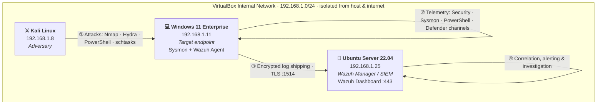

<h1 align="center">🛡️ SOC Home Lab — Detection Engineering & Adversary Simulation</h1>

<p align="center">
  <b>A fully isolated, cost-free SOC lab: Windows telemetry, Wazuh SIEM/XDR, Sysmon,<br>
  and 6 MITRE ATT&CK-mapped attack simulations — detected, triaged, and reported.</b>
</p>

<p align="center">
  
  
  
  
  
</p>

---

## 📌 Table of Contents

1. [Project Overview & Objectives](#-1-project-overview--objectives)
2. [Architecture & Network Isolation](#-2-architecture--network-isolation)
3. [Telemetry Pipeline](#-3-telemetry-pipeline)
4. [Detection Engineering](#-4-detection-engineering)
5. [Adversary Simulation Matrix](#-5-adversary-simulation-matrix)
6. [Incident Response & Reporting](#-6-incident-response--reporting)
7. [Evidence & Screenshots](#-7-evidence--screenshots)
8. [Lab Setup & Installation Guide](#-8-lab-setup--installation-guide)
9. [Repository Structure](#-9-repository-structure)
10. [Skills Demonstrated](#-10-skills-demonstrated)
11. [Legal & Authorized Use](#-11-legal--authorized-use)

---

## 📖 1. Project Overview & Objectives

This project is a **virtualized Security Operations Center (SOC) lab** built to practice the full
detection & response lifecycle the way it happens in production:

> **Simulate an attack → generate real telemetry → detect it with engineered rules →
> triage the alert → document and report it like a Tier-1 SOC Analyst.**

Unlike lab write-ups that upload flat sample CSV files, every event in this project is produced by
**real attack traffic** crossing a **real network** and ingested through a **real forwarding pipeline**
(Wazuh agent → Wazuh manager over TLS on port 1514).

### Objectives

| # | Objective | Where it lives |
|---|-----------|----------------|
| 1 | Build an isolated 3-node lab (attacker / target / SIEM) with no exposure to the host network | [`architecture/`](architecture/) |
| 2 | Ship Windows Security, Sysmon, PowerShell and Defender telemetry to a SIEM | [`configs/`](configs/) |
| 3 | Engineer custom detection rules mapped to MITRE ATT&CK | [`configs/local_rules.xml`](configs/local_rules.xml) |
| 4 | Execute 6 adversary simulations covering the ATT&CK kill chain | [`simulations/`](simulations/) |
| 5 | Investigate the resulting alerts with SIEM queries and write incident reports | [`queries/`](queries/) · [`incident-reports/`](incident-reports/) |

### Key Skills Demonstrated

`SIEM deployment & tuning` · `Log forwarding (Windows event channels)` · `Detection engineering (custom rules)`
· `SPL / SIEM query design` · `MITRE ATT&CK mapping` · `Adversary emulation` · `Alert triage & escalation`
· `Incident report writing` · `Network isolation` · `Sysmon telemetry`

---

## 🗺️ 2. Architecture & Network Isolation



### Network Breakdown

| Host Role | OS | IP Address | VM Resources | Function |
|-----------|----|------------|--------------|----------|
| **Attacker** | Kali Linux | `192.168.1.8` | 2 vCPU / 4 GB / 20 GB | Adversary emulation: recon, brute force, payload delivery |
| **Target** | Windows 11 Enterprise | `192.168.1.11` | 2 vCPU / 4 GB / 60 GB | User endpoint; Sysmon + Windows Event Logs; Wazuh agent |
| **SIEM** | Ubuntu Server 22.04 LTS | `192.168.1.25` | 4 vCPU / 8 GB / 50 GB | Wazuh Manager (indexer + server) & Dashboard (search head) |

### 🔒 Network Isolation Statement

All three VMs attach to a **VirtualBox Host-Only (internal) network** (`192.168.1.0/24`):

- The **host machine is not a member** of the lab subnet and is never targeted by simulations.
- The **lab has no route to the internet** at attack time (ISOs and agents are staged beforehand).
- Kali reaches the Wazuh dashboard **only through the internal subnet** (`https://192.168.1.25`).
- All attack traffic is confined to `192.168.1.8 → 192.168.1.11`. Nothing leaves the lab.

See [`architecture/README.md`](architecture/README.md) for the full topology and diagram source.

---

## 📡 3. Telemetry Pipeline

```
[ Kali 192.168.1.8 ] ── attacks ──▶ [ Windows 11 192.168.1.11 ]
                                          │
                     Windows Event Channels + Sysmon (SwiftOnSecurity config)
                                          │
                                  [ Wazuh Agent ]
                                          │  TLS encrypted, port 1514
                                          ▼
                             [ Wazuh Manager 192.168.1.25 ]
                                          │
                        decode → rule match → MITRE tagging → alert
                                          ▼
                             [ Wazuh Dashboard — SOC view ]
```

### Log Sources Ingested (agent-side `localfile` blocks — see [`configs/wazuh-agent-ossec.conf`](configs/wazuh-agent-ossec.conf))

| Event Channel | Examples of what it gives us | ATT&CK use |
|---------------|------------------------------|-------------|
| `Security` | 4624/4625 logons, 4688 process creation, 4698/4720 account & task changes, 1102 log cleared | Credential Access, Persistence, Defense Evasion |
| `Microsoft-Windows-Sysmon/Operational` | EID 1 process, EID 3 network, EID 11 file create, EID 13 registry | Execution, Discovery, Persistence |
| `Windows PowerShell` | Script block logging (4104), pipeline execution | Execution |
| `Microsoft-Windows-Windows Defender/Operational` | 1116/1117 malware detected/action taken | Execution, Impact |

> **Realism note:** telemetry is forwarded by a production agent (`WazuhSvc`) over an encrypted
> channel — not uploaded as pre-made log files. Timestamps, host context and rule correlation
> are exactly what a live SOC would see.

---

## 🔍 4. Detection Engineering

Custom detections are authored in Wazuh's rule language (XML) and mapped to MITRE ATT&CK.
Full rule file: [`configs/local_rules.xml`](configs/local_rules.xml) ·
Investigation queries: [`queries/`](queries/)

| Rule ID | Detection | ATT&CK | Severity |
|---------|-----------|--------|----------|
| `100101` | Brute force: ≥8 failed logons (4625) from one source in 120 s | T1110.001 | 🔴 High |
| `100102` | Successful logon immediately after brute-force burst | T1110.001 / T1078 | 🔴 High |
| `100110` | Suspicious PowerShell: encoded/hidden command, `downloadstring`, `IEX` | T1059.001 / T1105 | 🟠 Medium |
| `100120` | Windows audit log cleared via `wevtutil` | T1070.001 | 🔴 High |
| `100130` | Scheduled task creation (`schtasks /create`) | T1053.005 | 🟠 Medium |
| `100135` | Registry Run-key persistence (Sysmon EID 13) | T1547.001 | 🟠 Medium |
| `100140` | Recon command cluster (`whoami`, `systeminfo`, `net user`…) | T1082 / T1087 / T1033 | 🟡 Low–Med |
| `100145` | EICAR test-file / known malicious artifact write | T1204.002 | 🟠 Medium |

### Example investigation query (Wazuh Dashboard — OpenSearch DQL)

```
rule.groups: brute_force AND data.win.eventdata.ipAddress : 192.168.1.8
```

```
data.win.system.eventID : (4625 or 4624) AND agent.name : WIN11-PRO
| summarize count() by data.win.eventdata.ipAddress, data.win.eventdata.targetUserName, data.win.system.eventID
```

More ready-to-run queries (brute force, PowerShell, persistence, defense evasion, discovery)
in [`queries/`](queries/README.md).

---

## 🎯 5. Adversary Simulation Matrix

Six simulations spanning the ATT&CK kill chain — each documented as a repeatable runbook
with attack commands, expected telemetry, detection logic, triage steps and an evidence checklist.

| ID | Simulation | ATT&CK Technique | Tactic | Primary Telemetry |
|----|-----------|------------------|--------|-------------------|
| **SIM-01** | [Network & Host Discovery](simulations/SIM-01-network-host-discovery.md) | T1046 · T1082 · T1087 | Reconnaissance / Discovery | Sysmon EID 1 (recon commands) + visibility-gap analysis |
| **SIM-02** | [Brute Force → Valid Account](simulations/SIM-02-brute-force.md) | T1110.001 · T1078 | Credential Access | Security 4625 → 4624 |
| **SIM-03** | [Suspicious PowerShell Execution](simulations/SIM-03-suspicious-powershell.md) | T1059.001 · T1105 | Execution | Sysmon EID 1, PowerShell 4104 |
| **SIM-04** | [Persistence: Scheduled Task & Run Key](simulations/SIM-04-persistence.md) | T1053.005 · T1547.001 | Persistence | Security 4698, Sysmon EID 1 / 13 |
| **SIM-05** | [Defense Evasion: Log Clearing & Agent Tamper](simulations/SIM-05-defense-evasion.md) | T1070.001 · T1562.001 | Defense Evasion | Security 1102, agent-disconnect alerts |
| **SIM-06** | [Malware Delivery: EICAR Test File](simulations/SIM-06-malware-delivery.md) | T1204.002 · T1105 | Execution | Defender 1116/1117, Sysmon EID 11 |

**Status legend:** each runbook carries a status header (`Planned → Executed → Documented`).
Screenshot evidence lands in [`screenshots/`](screenshots/) following a strict naming convention.

---

## 🧾 6. Incident Response & Reporting

Every simulation is triaged the way a Tier-1 analyst works a queue:

1. **Validate** the alert (true/false positive?) → 2. **Scope** (which hosts, accounts, source IPs?)
→ 3. **Contain** (isolate host / disable account) → 4. **Escalate & document**.

- 📋 Report template: [`incident-reports/template.md`](incident-reports/template.md)
- 📝 Worked example (SIM-02 brute force): [`incident-reports/IR-2026-001-brute-force.md`](incident-reports/IR-2026-001-brute-force.md)
- 🧠 Triage methodology & ticket-quality checklist: [`incident-reports/README.md`](incident-reports/README.md)

---

## 🖼️ 7. Evidence & Screenshots

Evidence is captured **after executing each simulation** and committed to
[`screenshots/`](screenshots/) using the naming convention defined in
[`screenshots/README.md`](screenshots/README.md).

| # | Screenshot | Proves |
|---|-----------|--------|
| 01 | `01_virtualbox_network.png` | Proper network isolation (host-only adapter) |
| 02 | `02_wazuh_agent_active.png` | Real agent enrollment & log forwarding |
| 03 | `03_sysmon_event_viewer.png` | Sysmon telemetry on the endpoint |
| 04 | `04_hydra_bruteforce.png` | Attack execution from Kali |
| 05 | `05_event_4625_spike.png` | Failed-logon spike in raw Security log |
| 06 | `06_wazuh_alert_bruteforce.png` | Custom rule firing in the SIEM |
| 07 | `07_powershell_alert.png` | Suspicious PowerShell detection |
| 08 | `08_persistence_alert.png` | Persistence detection |
| 09 | `09_event_1102_log_cleared.png` | Defense-evasion detection |
| 10 | `10_defender_eicar_alert.png` | Malware detection |

> ⚠️ **Authenticity note:** screenshots are captured from **this lab only** — they are never
> generated or borrowed. Recruiters verify this in interviews; authenticity always wins.

<!--
Once screenshots are captured, uncomment to embed them here:


-->

---

## 🚀 8. Lab Setup & Installation Guide

> Full detail lives in [`architecture/`](architecture/) and [`configs/`](configs/).
> All software is free / open-source — total cost: **$0**.

### 📥 Downloads

| Component | Link |
|-----------|------|
| Hypervisor | [Oracle VirtualBox](https://www.virtualbox.org/wiki/Downloads) |
| Adversary OS | [Kali Linux ISO](https://www.kali.org/get-kali/) |
| Target OS | [Windows 11 Enterprise (Eval)](https://www.microsoft.com/en-us/evalcenter/evaluate-windows-11-enterprise) |
| SIEM host OS | [Ubuntu Server 22.04 LTS](https://ubuntu.com/download/server) |
| SIEM platform | [Wazuh Quickstart](https://documentation.wazuh.com/current/quickstart.html) |
| Telemetry agent | [Microsoft Sysmon](https://learn.microsoft.com/en-us/sysinternals/downloads/sysmon) + [SwiftOnSecurity config](https://github.com/SwiftOnSecurity/sysmon-config) |

### Phase 1 — VirtualBox Network Configuration

1. Open **VirtualBox** → `File` → `Tools` → `Network Manager`.
2. Create a **Host-Only Network** (`192.168.1.0/24`, DHCP off) and attach **all three VMs** to it.
3. Verify none of the VMs hold a NAT/bridged adapter at attack time — this keeps the lab isolated.

### Phase 2 — Ubuntu Server (Wazuh Manager)

```bash
sudo apt update && sudo apt upgrade -y
curl -sO https://packages.wazuh.com/4.7/wazuh-install.sh
sudo bash wazuh-install.sh -a
```

1. Static IP: `192.168.1.25` · 4 vCPU / 8 GB RAM / 50 GB disk.
2. Dashboard: `https://192.168.1.25` (self-signed TLS cert).
3. Install the custom detection rules: copy [`configs/local_rules.xml`](configs/local_rules.xml)
   to `/var/ossec/etc/rules/local_rules.xml` then `sudo systemctl restart wazuh-manager`.

### Phase 3 — Windows 11 Endpoint

1. Static IP: `192.168.1.11` · 2 vCPU / 4 GB RAM / 60 GB disk.
2. Install **Sysmon** with the SwiftOnSecurity config:

```powershell
.\Sysmon64.exe -i sysmonconfig-export.xml
```

3. Install the **Wazuh agent** and enroll it with the manager:

```powershell
.\wazuh-agent-4.7.0.msi /q WAZUH_MANAGER='192.168.1.25' WAZUH_REGISTRATION_SERVER='192.168.1.25'
NET START WazuhSvc
```

4. Apply [`configs/wazuh-agent-ossec.conf`](configs/wazuh-agent-ossec.conf) to forward the
   `Security`, `Sysmon`, `PowerShell` and `Defender` channels.

### Phase 4 — Kali Linux (Adversary)

1. Static IP: `192.168.1.8` · 2 vCPU / 4 GB RAM / 20 GB disk.
2. Confirm reachability: `ping 192.168.1.11`.
3. Run the simulations from [`simulations/`](simulations/) **in order**.

### ✅ Verification

- [ ] `192.168.1.11` shows **Active** under Wazuh → **Agents**.
- [ ] Events from all four Windows channels appear in **Threat intelligence → Security Events**.
- [ ] Executing a test `whoami` on the endpoint generates a process-creation event within seconds.
- [ ] Running SIM-02 raises custom rule `100101` on the dashboard.

---

## 📂 9. Repository Structure

```
SOC-HOME_LAB/
│
├── README.md                     ← You are here — project showcase
├── architecture/
│   └── README.md                 ← Topology, isolation design, diagram source
├── configs/
│   ├── wazuh-agent-ossec.conf    ← Real log-forwarding pipeline (event channels)
│   ├── local_rules.xml           ← Custom detection rules (MITRE-mapped)
│   └── sysmon-config-notes.md    ← Sysmon deployment notes & key Event IDs
├── queries/
│   ├── README.md                 ← How to investigate in the Wazuh dashboard
│   ├── credential-access.md      ← Brute force / account queries
│   ├── execution.md              ← PowerShell & malware queries
│   ├── persistence.md            ← Scheduled task / Run-key queries
│   ├── defense-evasion.md        ← Log clearing / tamper queries
│   └── discovery.md              ← Recon & discovery queries
├── simulations/
│   ├── README.md                 ← Simulation plan, safety rules, ATT&CK matrix
│   └── SIM-0*.md                 ← 6 attack runbooks (commands → detection → triage)
├── incident-reports/
│   ├── README.md                 ← Triage methodology & ticket checklist
│   ├── template.md               ← Reusable IR template
│   └── IR-2026-001-*.md          ← Worked incident report example
└── screenshots/
    └── README.md                 ← Evidence capture checklist & naming convention
```

---

## 🧠 10. Skills Demonstrated

| Domain | Evidence in this repo |
|--------|----------------------|
| SIEM administration | Wazuh all-in-one deployment, agent enrollment, rule management |
| Detection engineering | [`configs/local_rules.xml`](configs/local_rules.xml) — custom, threshold-based, MITRE-mapped |
| Log analysis | Windows Security / Sysmon / PowerShell / Defender channels |
| Query design | [`queries/`](queries/) — investigation queries per attack class |
| Adversary emulation | [`simulations/`](simulations/) — 6 ATT&CK-mapped runbooks |
| Incident response | [`incident-reports/`](incident-reports/) — triage, containment, escalation |
| Technical communication | This README + structured incident reports |
| Lab engineering | Isolated virtual network, resource planning, repeatability |

---

## ⚖️ 11. Legal & Authorized Use

All attack simulations were executed **exclusively inside an isolated host-only virtual network**
against systems I own and control, for **educational and defensive-detection purposes only**.
No traffic targeted any external or third-party system. Techniques are documented so that
**defenders** can detect them — never to be used against systems without explicit authorization.

---

<p align="center">
  <i>Built by <b>KHADER SHAREEF MADANI</b> · MIT License · If you're hiring for a SOC Analyst role, let's talk.</i>
</p>
