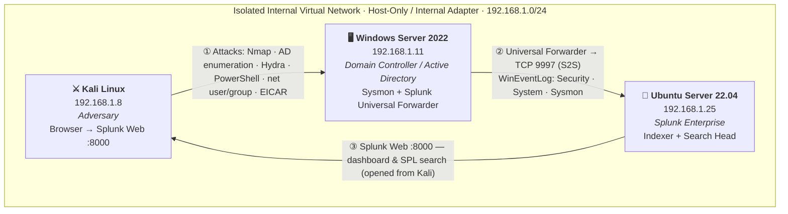

<h1 align="center">🛡️ SOC Home Lab — Detection Engineering & Adversary Simulation</h1>

<p align="center">
  <b>A fully isolated, cost-free SOC lab: Windows Server Active Directory telemetry,<br>
  Splunk Enterprise, a real Universal Forwarder pipeline, and 6 MITRE ATT&CK-mapped<br>
  attack simulations — detected with SPL, triaged, and reported.</b>
</p>

<p align="center">
  
  
  
  
  
  
</p>


## 📌 Table of Contents

1. [Project Overview & Objectives](#-1-project-overview--objectives)
2. [Architecture & Network Isolation](#-2-architecture--network-isolation)
3. [Telemetry Pipeline (Universal Forwarder → Splunk)](#-3-telemetry-pipeline-universal-forwarder--splunk)
4. [Detection Engineering with SPL](#-4-detection-engineering-with-spl)
5. [Adversary Simulation Matrix](#-5-adversary-simulation-matrix)
6. [Incident Response & Reporting](#-6-incident-response--reporting)
7. [Evidence & Screenshots](#-7-evidence--screenshots)
8. [Lab Setup & Installation Guide](#-8-lab-setup--installation-guide)
9. [Repository Structure](#-9-repository-structure)
10. [Skills Demonstrated](#-10-skills-demonstrated)
11. [Legal & Authorized Use](#-11-legal--authorized-use)

---

## 📖 1. Project Overview & Objectives

This project is a **virtualized Security Operations Center (SOC) lab** built to practice the
full detection & response lifecycle the way it happens in production:

> **Simulate an attack → generate real Windows/AD telemetry → detect it with SPL →
> triage the alert in Splunk → document and report it like a Tier-1 SOC Analyst.**

Unlike lab write-ups that upload flat sample CSV files, every event in this project is
produced by **real attack traffic** against a **real Domain Controller** and ingested
through a **real forwarding pipeline** (Splunk Universal Forwarder → Splunk Enterprise
indexer over TCP 9997 — the same S2S pipeline enterprises run).

### Objectives

| # | Objective | Where it lives |
|---|-----------|----------------|
| 1 | Build an isolated 3-node lab (attacker / AD Domain Controller / Splunk) with the host OS fully segregated | [`architecture/`](architecture/) |
| 2 | Ship `Security`, `System` and `Sysmon` telemetry to Splunk via a Universal Forwarder | [`configs/`](configs/) |
| 3 | Engineer 6 production-ready SPL detections, mapped to MITRE ATT&CK and scheduled as saved searches | [`configs/savedsearches.conf`](configs/savedsearches.conf) · [`queries/`](queries/) |
| 4 | Execute 6 adversary simulations covering the ATT&CK kill chain | [`simulations/`](simulations/) |
| 5 | Investigate the resulting alerts with SPL and write incident reports | [`queries/`](queries/) · [`incident-reports/`](incident-reports/) |

### Key Skills Demonstrated

`Splunk Enterprise administration` · `SPL query design` · `Universal Forwarder deployment`
· `Windows Event Log & Sysmon analysis` · `Detection engineering` · `MITRE ATT&CK mapping`
· `Adversary emulation` · `Alert triage & escalation` · `Incident report writing`
· `Network isolation` · `Active Directory security telemetry`

---

## 🗺️ 2. Architecture & Network Isolation



### Network Breakdown

| Host Role | OS | IP Address | VM Resources | Function |
|-----------|----|------------|--------------|----------|
| **Attacker** | Kali Linux | `192.168.1.8` | 2 vCPU / 4 GB / 20 GB | Adversary emulation: recon, brute force, payload delivery; Splunk Web client |
| **Target** | Windows Server 2022 | `192.168.1.11` | 2–4 vCPU / 4–8 GB / 60 GB | **Domain Controller / Active Directory**; Sysmon + Splunk Universal Forwarder |
| **SIEM** | Ubuntu Server 22.04 LTS | `192.168.1.25` | 4 vCPU / 8 GB / 50 GB | **Splunk Enterprise** — indexer & search head (data on TCP 9997, web on 8000) |

### 🔒 Network Isolation Statement

All three VMs attach to an **isolated internal virtual network** (VirtualBox Host-Only /
Internal Adapter, `192.168.1.0/24`):

- The **host OS is completely segregated** — it is not a member of the lab subnet and is
  never targeted by simulations.
- The **lab has no route to the internet** at attack time (ISOs and installers are staged beforehand).
- The **Splunk Web dashboard is accessed directly from Kali Linux** via web browser on
  **port 8000** (`http://192.168.1.25:8000`) — strictly over the internal subnet.
- All attack traffic is confined to `192.168.1.8 → 192.168.1.11`. Nothing leaves the lab.

See [`architecture/README.md`](architecture/README.md) for the full topology and diagram source.

---

## 📡 3. Telemetry Pipeline (Universal Forwarder → Splunk)

```
[ Windows Server DC 192.168.1.11 ]                 [ Ubuntu 192.168.1.25 ]
  Security · System · Sysmon logs                    Splunk Enterprise
          │                                          (Indexer + Search Head)
          │  Splunk Universal Forwarder
          │  inputs.conf  → collect WinEventLog
          │  outputs.conf → tcpout
          └──────────►  TCP 9997 (S2S)  ──────────►  index=main
                                                              │
                                            SPL saved searches & alerts
                                                              ▼
                                            Splunk Web :8000 (from Kali's browser)
```

### Forwarder configuration (see [`configs/`](configs/))

| File | Purpose |
|------|---------|
| [`configs/inputs.conf`](configs/inputs.conf) | `[WinEventLog://Security]`, `[WinEventLog://System]`, `[WinEventLog://Microsoft-Windows-Sysmon/Operational]` with `renderXml = true`, `evt_resolve_ad_obj = 1` → all to `index = main` |
| [`configs/outputs.conf`](configs/outputs.conf) | `[tcpout]` → `primary_indexers` → `<UBUNTU_SPLUNK_IP>:9997` |

### Log Sources Ingested

| Event Channel | Examples of what it gives us | ATT&CK use |
|---------------|------------------------------|-------------|
| `WinEventLog:Security` | 4624/4625 logons, 4661/4662 AD object access, 4720/4728/4732 account & group changes, 1102 log wiped | Credential Access, Discovery, Persistence, Defense Evasion |
| `WinEventLog:System` | Service state changes (e.g. 7036 — forwarder stopped) | Defense Evasion |
| `WinEventLog:Microsoft-Windows-Sysmon/Operational` | EID 1 process creation, EID 11 file create (XML) | Execution |

> **Realism note:** telemetry is forwarded by a production **Splunk Universal Forwarder**
> over the standard **S2S protocol on TCP 9997** — not uploaded as pre-made log files.
> `evt_resolve_ad_obj = 1` resolves AD object GUIDs, exactly as an enterprise deployment does.

---

## 🔍 4. Detection Engineering with SPL

All detections are **production-ready SPL** kept as runnable files in [`queries/`](queries/)
and deployed as scheduled alerts in [`configs/savedsearches.conf`](configs/savedsearches.conf).
Each one is mapped to MITRE ATT&CK.

| Saved search | SPL highlights | ATT&CK | Severity |
|--------------|----------------|--------|----------|
| AD Enumeration - Object Access 4662 4661 | `stats count by Account_Name, Object_Type, Source_Network_Address` | T1087.002 · T1069.002 | 🟡 Medium |
| Brute Force - 4625 4624 Correlation | `count(eval(EventCode=4625)) … \| where Failed_Logons > 5 \| eval Status=if(Successful_Logons>0, "CRITICAL…")` | T1110.001 · T1078 | 🔴 Critical |
| Suspicious PowerShell - Sysmon EventCode 1 | `Image="*powershell.exe"` + `DownloadString`/`EncodedCommand`/`bypass` | T1059.001 · T1105 | 🟠 High |
| Persistence - Account Creation and Group Elevation | `EventCode=4720/4732/4728` + `eval Action=case(…)` | T1136.001 · T1098 | 🟠 High |
| Defense Evasion - Audit Log Cleared 1102 | `EventCode=1102 \| table … Account_Name, Log_Name` | T1070.001 | 🔴 High |
| Malware Test - EICAR File Creation Sysmon 11 | `EventCode=11 \| search TargetFilename="*.eicar*"` | T1204.002 · T1105 | 🟠 High |

### Example: the flagship brute-force detection

```spl
index=main sourcetype="WinEventLog:Security" (EventCode=4625 OR EventCode=4624)
| stats count(eval(EventCode=4625)) as Failed_Logons, count(eval(EventCode=4624)) as Successful_Logons by Account_Name, Source_Network_Address
| where Failed_Logons > 5
| eval Status=if(Successful_Logons>0, "CRITICAL: Potential Compromise After Brute Force", "WARNING: Brute Force Attempt")
```

The `Status` field encodes the triage decision **in the query itself** — attempts-only vs
confirmed compromise. More ready-to-run searches and investigation pivots:
[`queries/README.md`](queries/README.md) · raw `.spl` files: [`queries/`](queries/).

---

## 🎯 5. Adversary Simulation Matrix

Six simulations spanning the ATT&CK kill chain — each documented as a repeatable runbook
with attack commands, expected EventCodes, the detection SPL, triage steps and an evidence
checklist.

| ID | Simulation | ATT&CK Technique | Tactic | Primary Telemetry |
|----|-----------|------------------|--------|-------------------|
| **SIM-01** | [AD Enumeration & Network Discovery](simulations/SIM-01-ad-enumeration.md) | T1087.002 · T1069.002 · T1046 | Discovery | Security 4662/4661 (+ gap analysis for scans) |
| **SIM-02** | [Brute Force → Valid Account](simulations/SIM-02-brute-force.md) | T1110.001 · T1078 | Credential Access | Security 4625 → 4624 |
| **SIM-03** | [Suspicious PowerShell Execution](simulations/SIM-03-suspicious-powershell.md) | T1059.001 · T1105 | Execution | Sysmon EID 1 |
| **SIM-04** | [Account Creation & Group Elevation](simulations/SIM-04-account-persistence.md) | T1136.001 · T1098 | Persistence | Security 4720/4732/4728 |
| **SIM-05** | [Defense Evasion: Audit Log Wipe & Forwarder Tamper](simulations/SIM-05-defense-evasion.md) | T1070.001 · T1562.001 | Defense Evasion | Security 1102 (+ System 7036) |
| **SIM-06** | [Malware Delivery: EICAR Test File](simulations/SIM-06-malware-delivery.md) | T1204.002 · T1105 | Execution | Sysmon EID 11 |

**Status legend:** each runbook carries a status header (`Planned → Executed → Documented`).
Screenshot evidence lands in [`screenshots/`](screenshots/) following a strict naming convention.

---

## 🧾 6. Incident Response & Reporting

Every simulation is triaged the way a Tier-1 analyst works a queue:

1. **Validate** the alert (true/false positive?) → 2. **Scope** (which hosts, accounts, source IPs?)
→ 3. **Contain** (isolate host / disable account) → 4. **Escalate & document**.

- 📋 Report template: [`incident-reports/template.md`](incident-reports/template.md)
- 📝 Worked example (SIM-02 brute force): [`incident-reports/IR-2026-001-brute-force.md`](incident-reports/IR-2026-001-brute-force.md)
- 🧠 Triage methodology & ticket-quality checklist: [`incident-reports/README.md`](incident-reports/README.md)

---

## 🖼️ 7. Evidence & Screenshots

Evidence is captured **after executing each simulation** and committed to
[`screenshots/`](screenshots/) using the naming convention defined in
[`screenshots/README.md`](screenshots/README.md).

| # | Screenshot | Proves |
|---|-----------|--------|
| 01 | `01_virtualbox_network.png` | Proper network isolation (host-only / internal adapter) |
| 02 | `02_splunk_forward_server.png` | Real Universal Forwarder pipeline (9997 ingestion) |
| 03 | `03_sysmon_event_viewer.png` | Sysmon telemetry arriving in Splunk (XML) |
| 04 | `04_hydra_bruteforce.png` | Attack execution from Kali |
| 05 | `05_event_4625_spike.png` | Failed-logon spike in SPL results |
| 06 | `06_splunk_alert_bruteforce.png` | Saved search firing with `Status` column |
| 07 | `07_splunk_alert_powershell.png` | Suspicious PowerShell detection |
| 08 | `08_splunk_alert_account.png` | Persistence (account/group) detection |
| 09 | `09_event_1102_log_cleared.png` | Defense-evasion detection |
| 10 | `10_splunk_alert_eicar.png` | Malware-delivery detection |
| 11 | `11_splunk_dashboard.png` | SOC dashboard: correlation & visualization |

> ⚠️ **Authenticity note:** screenshots are captured from **this lab only** — they are never
> generated or borrowed. Recruiters verify this in interviews; authenticity always wins.

<!--
Once screenshots are captured, uncomment to embed them here:


-->

---

## 🚀 8. Lab Setup & Installation Guide

> Full detail lives in [`architecture/`](architecture/) and [`configs/README.md`](configs/README.md).
> All software is free or evaluation-tier — total cost: **$0**.

### 📥 Downloads

| Component | Link |
|-----------|------|
| Hypervisor | [Oracle VirtualBox](https://www.virtualbox.org/wiki/Downloads) |
| Adversary OS | [Kali Linux ISO](https://www.kali.org/get-kali/) |
| Target OS | [Windows Server 2022 Evaluation](https://www.microsoft.com/en-us/evalcenter/evaluate-windows-server-2022) |
| SIEM host OS | [Ubuntu Server 22.04 LTS](https://ubuntu.com/download/server) |
| SIEM platform | [Splunk Enterprise (free lab license)](https://www.splunk.com/en_us/download/splunk-enterprise.html) |
| Telemetry agent | [Splunk Universal Forwarder](https://www.splunk.com/en_us/download/universal-forwarder.html) |
| Endpoint telemetry | [Microsoft Sysmon](https://learn.microsoft.com/en-us/sysinternals/downloads/sysmon) + [SwiftOnSecurity config](https://github.com/SwiftOnSecurity/sysmon-config) |

### Phase 1 — VirtualBox Network Configuration

1. Open **VirtualBox** → `File` → `Tools` → `Network Manager`.
2. Create a **Host-Only / Internal Network** (`192.168.1.0/24`, DHCP off) and attach
   **all three VMs** to it.
3. Verify none of the VMs hold a NAT/bridged adapter at attack time — this keeps the lab
   isolated and the host OS segregated.

### Phase 2 — Ubuntu Server (Splunk Enterprise)

1. Static IP: `192.168.1.25` · 4 vCPU / 8 GB RAM / 50 GB disk.
2. Install Splunk Enterprise (tarball/deb from splunk.com), then enable the receiver:

   ```bash
   cd /opt/splunk/bin
   ./splunk enable listen 9997 --accept-license --answer-yes --no-prompt
   ./splunk start --accept-license --answer-yes --no-prompt
   ```

3. Deploy the detection content:
   `cp configs/savedsearches.conf /opt/splunk/etc/apps/search/local/ && ./splunk restart`
4. Splunk Web: `http://192.168.1.25:8000` (admin account created at first login).

### Phase 3 — Windows Server 2022 (Domain Controller / Target)

1. Static IP: `192.168.1.11` · 2–4 vCPU / 4–8 GB RAM / 60 GB disk.
2. Add AD DS and promote to a new forest (e.g. `lab.local`):

   ```powershell
   Install-WindowsFeature AD-Domain-Services -IncludeManagementTools
   Install-ADDSForest -DomainName "lab.local" -InstallDns
   ```

3. Enable the audit policy needed for AD/credential events
   (see [`configs/sysmon-config-notes.md`](configs/sysmon-config-notes.md)).
4. Install **Sysmon** with the SwiftOnSecurity config: `.\Sysmon64.exe -i sysmonconfig-export.xml`
5. Install the **Splunk Universal Forwarder**, then copy [`configs/inputs.conf`](configs/inputs.conf)
   and [`configs/outputs.conf`](configs/outputs.conf) into
   `C:\Program Files\SplunkUniversalForwarder\etc\system\local\`
   (replace `<UBUNTU_SPLUNK_IP>` with `192.168.1.25`) and restart the forwarder.
6. Verify: `splunk list forward-server` → `192.168.1.25:9997`.

### Phase 4 — Kali Linux (Adversary + Splunk Web client)

1. Static IP: `192.168.1.8` · 2 vCPU / 4 GB RAM / 20 GB disk.
2. Confirm reachability: `ping 192.168.1.11`.
3. Open **Splunk Web** from the Kali browser: `http://192.168.1.25:8000`.
4. Run the simulations from [`simulations/`](simulations/) **in order**.

### ✅ Verification

- [ ] `index=main | stats count by sourcetype, host` shows `WinEventLog:Security`, `WinEventLog:System`, `WinEventLog:Microsoft-Windows-Sysmon/Operational` from `WIN-DC01`.
- [ ] Splunk Web opens from the Kali browser on `http://192.168.1.25:8000`.
- [ ] Executing a test `whoami` on the DC produces a Sysmon EventCode 1 in Splunk within seconds.
- [ ] Running SIM-02 triggers the saved search **Brute Force - 4625 4624 Correlation**.

---

## 📂 9. Repository Structure

```
SOC-HOME_LAB/
│
├── README.md                     ← You are here — project showcase
├── architecture/
│   └── README.md                 ← Topology, isolation design, diagram source
├── configs/
│   ├── README.md                 ← Deployment order & verification steps
│   ├── inputs.conf               ← Universal Forwarder: WinEventLog collection
│   ├── outputs.conf              ← Universal Forwarder → indexer (TCP 9997)
│   ├── savedsearches.conf        ← 6 SPL detections as scheduled alerts
│   └── sysmon-config-notes.md    ← Sysmon deployment + audit policy (DC)
├── queries/
│   ├── README.md                 ← Query index, field reference, triage pivots (SPL)
│   ├── 01-ad-enumeration.spl     ← SIM-01 detection (4662/4661)
│   ├── 02-brute-force.spl        ← SIM-02 detection (4625/4624)
│   ├── 03-powershell-execution.spl ← SIM-03 detection (Sysmon 1)
│   ├── 04-account-persistence.spl  ← SIM-04 detection (4720/4732/4728)
│   ├── 05-log-wipe.spl           ← SIM-05 detection (1102)
│   └── 06-eicar-file-create.spl  ← SIM-06 detection (Sysmon 11)
├── simulations/
│   ├── README.md                 ← Simulation plan, safety rules, ATT&CK matrix
│   └── SIM-0*.md                 ← 6 attack runbooks (commands → SPL → triage)
├── incident-reports/
│   ├── README.md                 ← Triage methodology & ticket checklist
│   ├── template.md               ← Reusable IR template
│   └── IR-2026-001-*.md          ← Worked incident report example
└── screenshots/
    └── README.md                 ← Evidence capture checklist & naming convention
```

---

## 🧠 10. Skills Demonstrated

| Domain | Evidence in this repo |
|--------|----------------------|
| Splunk administration | Enterprise install, receiver on 9997, saved searches, dashboard |
| Query language | [`queries/*.spl`](queries/) — production-ready SPL (`stats`, `eval`, `where`, `case`) |
| Detection engineering | [`configs/savedsearches.conf`](configs/savedsearches.conf) — scheduled, ATT&CK-mapped, tuned |
| Log forwarding | [`configs/inputs.conf`](configs/inputs.conf) + [`outputs.conf`](configs/outputs.conf) — real UF pipeline |
| Log analysis | Windows Security (4624/4625/4661/4662/4720/4728/4732/1102) + Sysmon (1/11) |
| Adversary emulation | [`simulations/`](simulations/) — 6 ATT&CK-mapped runbooks |
| Incident response | [`incident-reports/`](incident-reports/) — triage, containment, escalation |
| Technical communication | This README + structured incident reports |
| Lab engineering | Isolated internal network, AD domain, resource planning, repeatability |

---

## ⚖️ 11. Legal & Authorized Use

All attack simulations were executed **exclusively inside an isolated internal virtual
network** against systems I own and control, for **educational and defensive-detection
purposes only**. No traffic targeted any external or third-party system. Techniques are
documented so that **defenders** can detect them — never to be used against systems
without explicit authorization.

---

<p align="center">
  <i>Built by <b>KHADER SHAREEF MADANI</b> · MIT License · If you're hiring for a SOC Analyst role, let's talk.</i>
</p>
