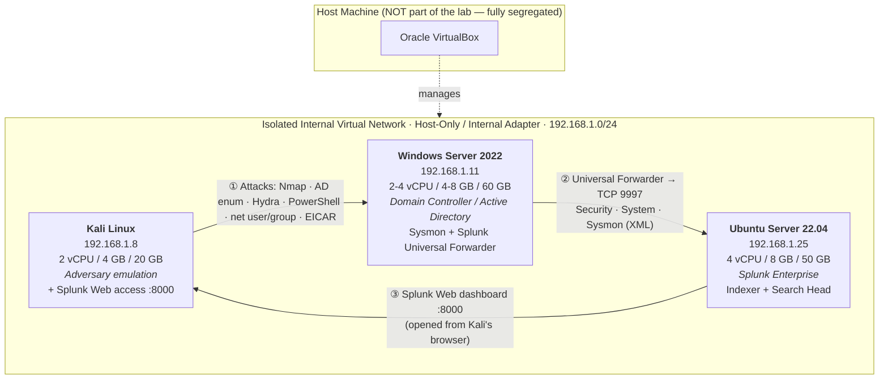

# 🏗️ Architecture & Network Design

This folder documents the lab topology and the isolation controls that keep all
adversary simulation traffic confined to the virtual environment.

## Topology Diagram

> 📸 Export this diagram to `network-diagram.png` (see [Exporting the Diagram](#exporting-the-diagram))
> and commit it here — recruiters expect a visual topology.

## Host Inventory

| Host | OS | IP | vCPU | RAM | Disk | Role |
|------|----|----|------|-----|------|------|
| Kali Linux | Kali 2024.x | `192.168.1.8` | 2 | 4 GB | 20 GB | Attacker / adversary emulation + Splunk Web client |
| Windows Server | Windows Server 2022 | `192.168.1.11` | 2–4 | 4–8 GB | 60 GB | **Domain Controller / Active Directory** (target + log source) |
| Ubuntu Server | Ubuntu 22.04 LTS | `192.168.1.25` | 4 | 8 GB | 50 GB | **Splunk Enterprise** (indexer + search head) |

## The SIEM Platform: Splunk Enterprise

| Component | Detail |
|-----------|--------|
| Splunk Enterprise | Ubuntu Server `192.168.1.25` — indexer **and** search head (all-in-one lab deployment) |
| Data ingestion | **TCP 9997** (Splunk-to-Splunk / S2S protocol from the Universal Forwarder) |
| Splunk Web UI | **TCP 8000** — accessed directly from **Kali Linux** via web browser |
| Index | `main` (all lab telemetry) |
| Detection content | [`../configs/savedsearches.conf`](../configs/savedsearches.conf) (scheduled SPL alerts) |

## Log Source: Windows Server Domain Controller

The target is not a plain workstation — it is a **Domain Controller with Active Directory**,
which is why the detections cover enterprise-authentic telemetry:

| Channel | Collected via | Key events |
|---------|---------------|------------|
| `WinEventLog://Security` | Universal Forwarder (`inputs.conf`) | 4624/4625 logons · 4661/4662 AD object access · 4720/4728/4732 account & group changes · 1102 log wiped |
| `WinEventLog://System` | Universal Forwarder | Service/system health events |
| `WinEventLog://Microsoft-Windows-Sysmon/Operational` | Universal Forwarder (`renderXml = true`) | EID 1 process creation · EID 11 file create |

## Network Isolation Design

| Control | Implementation | Purpose |
|---------|----------------|---------|
| Isolated internal network | VirtualBox **Host-Only / Internal** adapter, `192.168.1.0/24` | VMs reach each other only; no internet path during attack windows |
| Host OS segregation | The physical/host OS is **not** a member of the lab subnet and is never targeted | Hard boundary for authorized testing |
| Static addressing | Manual IPs per the inventory table | Stable detection rules & evidence (source IP = attribution) |
| Splunk Web access path | Kali browser → `http://192.168.1.25:8000` over the internal network only | Dashboard is reachable only inside the lab |
| Forwarder shipping | UF → indexer on TCP `9997` (S2S) | Realistic production ingestion pipeline |
| Firewall posture | DC inbound default-deny; only required services (SMB/RPC/WinRM/RDP/LDAP) allowed from the subnet | Mirrors a hardened domain controller |

### Why Host-Only / Internal (not bridged)?

A bridged adapter would place Kali on the **real LAN**, meaning scan and brute-force
traffic could touch the host or other devices. The isolated internal network guarantees
the authorized-testing boundary: everything documented here happened strictly between
three VMs, with the host OS fully segregated.

### Optional hardening (stretch goals)

- Add a **pfSense/OPNsense VM** and ingest firewall logs into Splunk (`index=main sourcetype=pfsense`).
- Enable **Windows Firewall logging** and ingest with a second `WinEventLog`/file input to
  close the external-scan visibility gap (see SIM-01 runbook).
- Run a **separate search head** VM to practice distributed Splunk architecture.

## Exporting the Diagram

1. Copy the Mermaid source above into [mermaid.live](https://mermaid.live) (or VS Code's
   Markdown Preview Mermaid Support extension).
2. Export as **PNG** (transparent background works nicely).
3. Save it as `architecture/network-diagram.png` and commit it.
4. Embed it in the root `README.md` with ``.

> Alternatively redraw it in [draw.io](https://app.diagrams.net) for a polished look —
> use the same IPs and labels so the diagram matches the documentation exactly.
