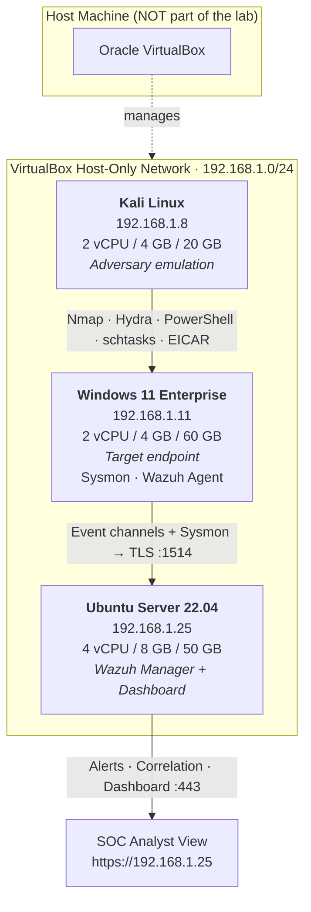

# 🏗️ Architecture & Network Design

This folder documents the lab topology and the isolation controls that keep all
adversary simulation traffic confined to the virtual environment.

## Topology Diagram

> 📸 Export this diagram to `network-diagram.png` (see [Exporting the Diagram](#exporting-the-diagram))
> and commit it here — recruiters expect a visual topology.

## Host Inventory

| Host | OS | IP | vCPU | RAM | Disk | Role |
|------|----|----|------|-----|------|------|
| Kali Linux | Kali 2024.x | `192.168.1.8` | 2 | 4 GB | 20 GB | Attacker / adversary emulation |
| Windows 11 | Windows 11 Enterprise (Eval) | `192.168.1.11` | 2 | 4 GB | 60 GB | Target endpoint (telemetry source) |
| Ubuntu Server | Ubuntu 22.04 LTS | `192.168.1.25` | 4 | 8 GB | 50 GB | Wazuh Manager (SIEM), Dashboard |

## Network Isolation Design

| Control | Implementation | Purpose |
|---------|----------------|---------|
| Host-only network | VirtualBox Host-Only adapter `vboxnet0`, `192.168.1.0/24`, DHCP disabled | VMs can talk to each other only; no internet path |
| Static addressing | Manual IPs per the inventory table | Stable detection rules & evidence (source IP = attribution) |
| No NAT/bridged adapters | Removed from all VMs during attack windows | Prevents any accidental traffic to the host or LAN |
| Firewall posture | Windows inbound default-deny; only RDP/SMB/ICMP allowed from the subnet | Mirrors a hardened enterprise endpoint |
| Encrypted shipping | Wazuh agent → manager over TLS (TCP 1514) | Realistic production telemetry pipeline |

### Why Host-Only (not bridged)?

A bridged adapter would place Kali on the **real LAN**, meaning scan and brute-force traffic
could touch the host or other household/office devices. A host-only network guarantees the
authorized-testing boundary: everything visible in this repository happened between three VMs.

### Optional hardening (stretch goals)

- Add a **pfSense/OPNsense VM** in the path and ingest firewall logs into Wazuh.
- Put Kali on a **separate internal segment** and route through the firewall for realistic
  network-boundary telemetry (and to practice firewall-rule tuning).

## Exporting the Diagram

1. Copy the Mermaid source above into [mermaid.live](https://mermaid.live) (or VS Code's
   Markdown Preview Mermaid Support extension).
2. Export as **PNG** (transparent background works nicely).
3. Save it as `architecture/network-diagram.png` and commit it.
4. Embed it in the root `README.md` with ``.

> Alternatively redraw it in [draw.io](https://app.diagrams.net) for a polished look —
> use the same IPs and labels so the diagram matches the documentation exactly.
